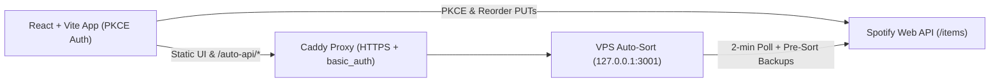

<div align="center">

# Spotify Playlist Sorter

**Sort playlists permanently across every device — without losing your `added_at` dates.**

[](https://react.dev/)
[](https://www.typescriptlang.org/)
[](https://vite.dev/)
[](https://tailwindcss.com/)
[](https://vitest.dev/)
[](LICENSE)

[Features](#features) · [Why This Exists](#why-this-exists) · [How It Works](#how-it-works) · [Local Setup](#local-setup) · [Self-Hosting](DEPLOYMENT.md) · [Project Structure](#project-structure)

</div>

---

## Why This Exists

Spotify's built-in playlist sorting (**Title**, **Date added**, **Artist**) is **local view state only**. Sorting on your phone does not change the order on Smart TVs, cars, or desktop clients.

Instead of clearing and re-adding songs (which destroys your **Date Added** history), this app permanently rewrites each playlist's canonical **Custom order** using minimal, block-aware `PUT /v1/playlists/{id}/items` moves—so every device shows the exact same order.

| Capability | This App (`PUT` Reorder) | Naive Replace (`{ uris }`) |
| :--- | :---: | :---: |
| Preserves original `added_at` dates | **Yes** | Overwrites all to "now" |
| Playlists over 100 items | **Unlimited** | Capped at 100 items |
| Local files (`spotify:local:`) | **Supported** | Rejected by API |
| Duplicate tracks in same playlist | **Exact order preserved** | Fragile without key tracking |
| Minimizes API calls | **LIS + contiguous blocks** | Full playlist rewrite |

---

## Features

### Sorting, Smart Mixes & Editing
- **14 Quick Presets** + **4-Level Multi-Rule Builder** — Sort by Date Added, Title *(with optional `"The / A / An"` article stripping)*, Artist, Album *(with automatic Disc # + Track # tie-breaking)*, Release Date (`YYYY` / `YYYY-MM` / `YYYY-MM-DD`), Duration, Added By, Explicit/Clean, or Reverse Order.
- **Smart Mixes** — **Artist Spread** *(spaces repeated artists evenly across the playlist)* and **True Shuffle** *(Fisher-Yates + anti-clump pass)*.
- **Interactive Draft Table** — Live `#Before → #After` position diff badges, estimated API call count, `Shift+Click` range selection, multi-item `@dnd-kit` drag-and-drop *(virtualized via `@tanstack/react-virtual` above 300 rows)*, and bulk move actions (`Top`, `Bottom`, `Up`, `Down`, `Move to #Pos`, `Swap 2`).

### Optional 24/7 Background Auto-Sort
- Lightweight standalone Node service (`server/`, bundled to a single ESM file) that polls `GET /v1/me/playlists` every **2 minutes** (**1 API call** when nothing changed).
- Automatically moves newly added songs into your chosen order *(e.g. **Date Added: Newest First**)* right after you add them from your phone.
- Saves an automatic pre-sort snapshot on disk before every automatic reorder.

### Safety, Backups & Privacy
- **Conflict & Rate-Limit Protection** — Pre-commit `snapshot_id` + total-count verification, `429 Retry-After` countdown/backoff, and clean pause/cancel between steps.
- **Multi-Layer Backups** — Automatic pre-commit browser `localStorage` snapshots (10 per playlist), VPS disk snapshots (20 per playlist), and portable `.json` export/import.
- **2026 Spotify Web API Ready** — Built for `/playlists/{id}/items` (`additional_types=track,episode`, `row.item` schema), `127.0.0.1` loopback rules, and Development Mode limits.
- **Login-Only Gate** — OAuth 2.0 PKCE (`AuthGuard`, zero `client_secret`), optional `VITE_ALLOWED_SPOTIFY_USER_ID` lock, optional in-browser Client ID entry, and Caddy `basic_auth` deployment support.

> [!NOTE]
> **Spotify API Scope Limits:** You can reorder any playlist you **own** or **collaborate on**. Spotify's Web API does not allow reordering *Liked Songs*, read-only/editorial playlists, or sidebar library folders.

---

## How It Works



1. **Load & Key:** Every row (tracks, podcast episodes, local files, unavailable entries) receives an immutable load-time `instanceKey` so duplicate URIs never collide.
2. **Plan Minimal Moves:** [diffPlanner.ts](src/sorter/diffPlanner.ts) finds the `O(N log N)` Longest Increasing Subsequence (items already in relative order stay untouched), groups adjacent moves into contiguous `range_length > 1` blocks, and asserts locally that the move plan reproduces the target array 100% before making a single write.
3. **Commit Safely:** [reorderRunner.ts](src/api/reorderRunner.ts) verifies the live `snapshot_id`, saves a backup, chains each new `snapshot_id` across sequential `PUT` calls, and re-fetches to verify the final live order.

---

## Local Setup

### 1. Create a Spotify Developer App
1. Open the [Spotify Developer Dashboard](https://developer.spotify.com/dashboard) and click **Create app** *(requires an active Spotify Premium subscription on the owner account)*.
2. Under **Which API/SDKs are you planning to use?**, check **Web API**.
3. Add **Redirect URIs**:
   - Local dev: `http://127.0.0.1:3000/callback`
   - Self-hosted VPS *(optional)*: `https://203-0-113-10.sslip.io/callback` *(see [DEPLOYMENT.md](DEPLOYMENT.md))*
4. Save and copy your **Client ID** *(Client Secret is not needed for PKCE)*.

> [!IMPORTANT]
> Spotify explicitly rejects `http://localhost:...` redirect URIs. Always access local dev via **`http://127.0.0.1:3000`**.

### 2. Install & Run
```bash
git clone https://github.com/edgarasb-dev/spotify-sorter.git
cd spotify-sorter
npm install
cp .env.example .env
```

Configure `.env`:
| Variable | Purpose |
| :--- | :--- |
| `VITE_SPOTIFY_CLIENT_ID` | Your Spotify App Client ID *(or leave blank to enter it once in the browser login form)* |
| `VITE_SPOTIFY_REDIRECT_URI` | Optional override; defaults automatically to `${window.location.origin}/callback` |
| `VITE_ALLOWED_SPOTIFY_USER_ID` | *(Recommended)* Lock login exclusively to your own Spotify user ID |

Run tests and start the dev server:
```bash
npm test      # Run Vitest unit suite
npm run dev   # Starts at http://127.0.0.1:3000
```

---

## Self-Hosting

Ready to deploy on a small VPS (Ubuntu/Oracle Free Tier) with automatic HTTPS, `basic_auth`, no-domain `sslip.io` support, and optional 24/7 background auto-sorting?

👉 Follow the complete step-by-step guide in **[DEPLOYMENT.md](DEPLOYMENT.md)**.

---

## Project Structure

```text
├── DEPLOYMENT.md                           # Full VPS + Caddy + systemd auto-sort guide
├── deploy/
│   ├── Caddyfile.example                   # Caddy HTTPS + basic_auth + /auto-api proxy
│   └── spotify-sorter-autosort.service     # systemd unit for 24/7 VPS auto-sort
├── server/
│   ├── autoSortEngine.ts                   # Polling loop, serialized token refresh, disk backups
│   └── autoSortServer.ts                   # Local HTTP API (/auto-api/*)
├── src/
│   ├── api/                                # Spotify /items client, normalizer, reorder runner
│   ├── auth/                               # OAuth 2.0 PKCE + owner lock + VPS session sync
│   ├── components/                         # LoginScreen, AuthGuard, TrackTable, Modals, Drawer
│   ├── sorter/                             # Comparators, Smart Mixes, LIS Diff Planner, Presets
│   ├── storage/                            # localStorage & shared backup snapshot planner
│   └── tests/                              # Vitest unit tests
```

---

## Tech Stack

- **Frontend:** React 19, TypeScript, Vite 8, Tailwind CSS v4
- **Drag & Drop / Virtualization:** `@dnd-kit/core`, `@dnd-kit/sortable`, `@tanstack/react-virtual`
- **Auto-Sort Server:** Zero-dependency Node.js HTTP server bundled with `rolldown`
- **Testing:** Vitest

---

## License

Released under the [MIT License](LICENSE).
